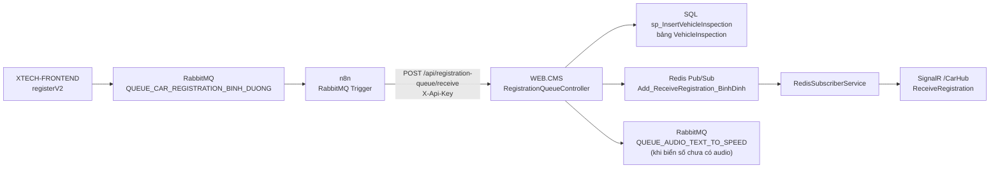
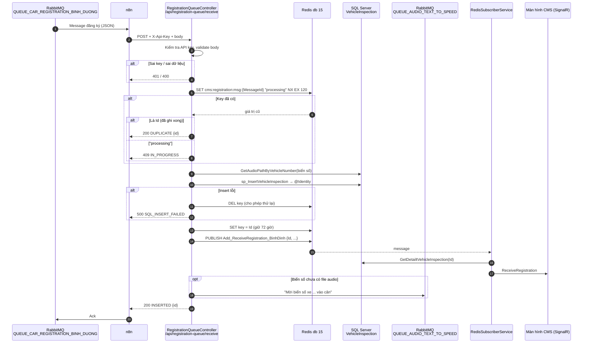
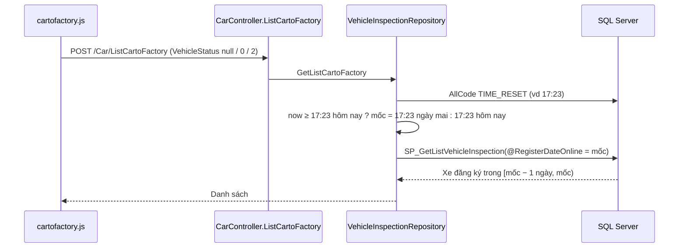

# WEB.CMS – API nhận đăng ký xe từ n8n (Bình Dương)

> Tài liệu này phải được cập nhật mỗi khi code liên quan trong `WEB.CMS` thay đổi.
> Lịch sử thay đổi xem ở [CHANGELOG.md](CHANGELOG.md).
> Phía tạo message (form tài xế) xem `source/XTECH-FRONTEND/Docs/README.md`.

## 1. Mục đích

XTECH-FRONTEND cấp số thứ tự và đẩy message đăng ký vào RabbitMQ.
**n8n** đóng vai trò consumer: node RabbitMQ hứng message rồi gọi HTTP vào API của WEB.CMS.
WEB.CMS ghi bảng `VehicleInspection` (DB `Cargill_BinhDuong_v2`) và báo realtime cho các màn hình CMS.



## 2. Endpoint

`POST /api/registration-queue/receive`

| Thành phần | Giá trị |
|---|---|
| Header bắt buộc | `X-Api-Key: <RegistrationConsumer:ApiKey>`, `Content-Type: application/json` |
| Body | Nguyên message RabbitMQ (JSON) – không cần biến đổi |
| Xác thực | Không dùng cookie đăng nhập CMS (`[AllowAnonymous]`), chỉ kiểm tra API key |

Body mẫu:

```json
{
  "MessageId": "8f2c4a9e-1b2c-4d5e-8f90-112233445566",
  "Site": "BINH_DUONG",
  "LocationType": 3,
  "BusinessDate": "2026-10-04",
  "QueueNumber": 1,
  "RegistrationTime": "2026-10-04T23:02:39.326+07:00",
  "PlateNumber": "30E45321",
  "PhoneNumber": "0942066299",
  "Name": "CƯỜNG - 123456",
  "GPLX": "LÊ VĂN CƯỜNG",
  "Referee": "0",
  "Camp": "test1111",
  "ZaloStatus": "Đang xử lý..."
}
```

curl:

```bash
curl -X POST "https://<domain-cms-binh-duong>/api/registration-queue/receive" \
  -H "Content-Type: application/json" \
  -H "X-Api-Key: <api-key>" \
  -d @message.json
```

### Mã phản hồi và cách n8n xử lý

| HTTP | `code` | Ý nghĩa | n8n nên |
|---|---|---|---|
| 200 | `INSERTED` | Đã ghi SQL, trả `id` | Ack |
| 200 | `DUPLICATE` | `MessageId` đã ghi trước đó, trả `id` cũ | Ack |
| 400 | `INVALID_MESSAGE` | Thiếu `MessageId` / `PlateNumber`, `QueueNumber` ≤ 0, sai `Site`... | Ack + lưu lại để xem (gửi lại vẫn lỗi) |
| 401 | `UNAUTHORIZED` | Sai / thiếu `X-Api-Key` | Dừng, sửa cấu hình |
| 409 | `IN_PROGRESS` | Cùng `MessageId` đang được xử lý | Thử lại sau vài giây |
| 500 | `SQL_INSERT_FAILED`, `SERVER_ERROR` | Lỗi SQL / lỗi hệ thống | Thử lại (không ack) |
| 503 | `REDIS_UNAVAILABLE` | Không kết nối Redis | Thử lại (không ack) |

Response mẫu:

```json
{ "success": true, "code": "INSERTED", "message": "Thêm mới thành công", "id": 1234, "messageId": "8f2c4a9e-..." }
```

## 3. Luồng xử lý (Sequence)



## 4. Ánh xạ message → `sp_InsertVehicleInspection`

| Message | Tham số SP | Ghi chú |
|---|---|---|
| `QueueNumber` | `@RecordNumber` | Số thứ tự do FE cấp, **không** cấp lại |
| `Name` | `@CustomerName` | |
| `PlateNumber` | `@VehicleNumber` | Trim + in hoa |
| `RegistrationTime` | `@RegisterDateOnline` | |
| `GPLX` | `@DriverName` | FE dùng ô này cho tên lái xe |
| `Camp` | `@LicenseNumber` | Ghi chú |
| `PhoneNumber` | `@PhoneNumber` | |
| `Referee` | `@VehicleLoad` | |
| (tra theo biển số) | `@AudioPath` | Lấy từ `GetAudioPathByVehicleNumber` |

Code ghi: `Repositories.VehicleInspectionRepository.SaveVehicleInspection` → `DAL.VehicleInspectionDAL.SaveVehicleInspection`.

Các màn CMS đọc dữ liệu này: `Car/RegisteredVehicle`, `Car/CartoFactory`, `Car/ProcessingIsLoading`,
`Car/CallTheScale`, `Car/WeighedInput`, `SummaryReport/TotalVehicleInspection`.

### 4.1 Màn "Danh sách xe đăng ký" (`Car/CartoFactory`) lọc theo đợt

`CarController.ListCartoFactory` → `VehicleInspectionRepository.GetListCartoFactory` → `SP_GetListVehicleInspection`.

- Repository tính `@RegisterDateOnline` = giờ `TIME_RESET` **kế tiếp**: chưa tới giờ reset hôm nay → reset hôm nay;
  đã qua → reset ngày mai. Khớp `BusinessDate` mà XTECH-FRONTEND gán cho số thứ tự.
- SP lấy xe có `RegisterDateOnline` trong `[@RegisterDateOnline − 1 ngày, @RegisterDateOnline)`,
  cộng thêm xe `VehicleStatus = 0` (đã đến nhà máy) đăng ký từ hôm nay.
- Script: `source/Scripts/SP_GetListVehicleInspection_20261015.sql`.



Ví dụ reset 17:23: lúc 22:53 ngày 15/10, mốc = 16/10 17:23 → hiện xe đăng ký từ 15/10 17:23 trở đi.

**Lưu ý:** 8 SP khác (`SP_GetListVehicleCallTheScale`, `SP_GetListVehicleCarCallList`, `SP_GetListVehicleProcessingIsLoading`,
`SP_GetListVehicleWeighedInput`, `SP_GetListVehicleListVehicles`, `SP_GetListCartoFactory_EX`,
`SP_GetListVehicleInspectionSynthetic`, `SP_CountTotalVehicleInspectionSynthetic`) vẫn lấy mốc "xe `RecordNumber = 1`":
nếu đợt đó không có xe số 1 trong SQL, các màn này sẽ trống. Các màn đó vẫn dùng giờ reset **hôm nay** (chưa đổi).

## 5. Cấu hình (`appsettings.json`)

| Key | Mặc định | Ý nghĩa |
|---|---|---|
| `RegistrationConsumer:ApiKey` | (bắt buộc) | Key n8n gửi ở header `X-Api-Key`. Để trống → mọi request bị 401 |
| `RegistrationConsumer:Site` | `BINH_DUONG` | Chỉ nhận message có `Site` trùng. Để trống → không kiểm tra |
| `RegistrationConsumer:RealtimeChannel` | `Add_ReceiveRegistration_BinhDinh` | Kênh Redis mà `RedisSubscriberService` đang subscribe |
| `RegistrationConsumer:ProcessedKeyHours` | `72` | Thời gian nhớ `MessageId` đã xử lý |
| `Redis:Database:db_common` | `15` | DB Redis lưu key chống trùng |
| `Queue:QueueSyncES` | `QUEUE_AUDIO_TEXT_TO_SPEED` | Queue tạo audio đọc biển số |

## 6. Key Redis

| Key | Giá trị | TTL | Ý nghĩa |
|---|---|---|---|
| `cms:registration:msg:{MessageId}` | `processing` | 2 phút | Đang xử lý (khóa chống 2 lần gọi song song) |
| `cms:registration:msg:{MessageId}` | Id `VehicleInspection` | 72 giờ | Đã ghi xong, gọi lại trả `DUPLICATE` |

## 7. Cấu hình n8n gợi ý

Workflow mẫu: [n8n-registration-consumer.json](n8n-registration-consumer.json). Mở file, copy toàn bộ,
dán (Ctrl+V) vào canvas n8n, nối node RabbitMQ Trigger vào node `format data Registration FrontEnd`,
sửa `DOMAIN-CMS-BINH-DUONG` trong node HTTP Request.

Message RabbitMQ đến n8n có dạng `{ fields, properties, content: "<chuỗi JSON>" }`.
Node Code parse `content` thành object rồi node HTTP gửi `JSON.stringify($json)` làm body.

1. **RabbitMQ Trigger**: queue `QUEUE_CAR_REGISTRATION_BINH_DUONG`, vhost `booking_car`,
   bật *Durable*, chọn *Acknowledge: Later / When Execution Finishes Successfully*
   (không dùng *Immediately*, nếu không lỗi sẽ mất message). Parallel messages: 1–5.
2. **Code / Set** (nếu cần): parse `content` thành JSON.
3. **HTTP Request**: `POST https://<domain-cms>/api/registration-queue/receive`,
   header `X-Api-Key`, body JSON = message. Retry on fail: 3 lần, chờ 5 giây.
   Coi `200` là thành công. `400` → ghi lại (Google Sheet / Telegram) rồi kết thúc thành công để ack.
4. Lỗi `401/409/500/503` sau khi hết retry → để execution lỗi, message không bị ack và RabbitMQ giao lại.

## 8. Lưu ý

- Khóa chống trùng nằm ở Redis. Nếu Redis mất dữ liệu trong vòng 72 giờ, message gửi lại có thể bị insert trùng.
  Muốn chắc chắn tuyệt đối cần thêm unique index SQL (ví dụ `(RecordNumber, ngày RegisterDateOnline)`).
- Trường hợp hiếm: SQL ghi xong nhưng lưu Id vào Redis lỗi → sau 2 phút gửi lại có thể bị trùng.
- `appsettings.json` chứa API key, không commit lên kho công khai. Đổi key thì cập nhật cả n8n.
