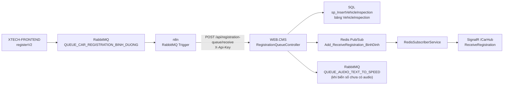
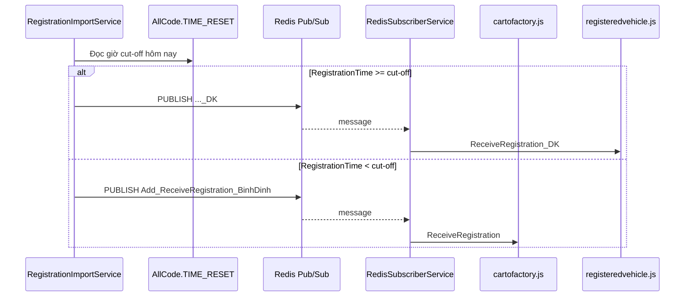

# WEB.CMS – API nhận đăng ký xe từ n8n (Bình Dương)

> Tài liệu này phải được cập nhật mỗi khi code liên quan trong `WEB.CMS` thay đổi.
> Lịch sử thay đổi xem ở [CHANGELOG.md](CHANGELOG.md).
> Phía tạo message (form tài xế) xem `source/XTECH-FRONTEND/Docs/README.md`.

## 1. Mục đích

XTECH-FRONTEND cấp số thứ tự và đẩy message đăng ký vào RabbitMQ.
**n8n** đóng vai trò consumer: node RabbitMQ hứng message rồi gọi HTTP vào API của WEB.CMS.
WEB.CMS ghi bảng `VehicleInspection` (DB `Cargill_BinhDuong_v2`) và báo realtime cho các màn hình CMS.



## 2. Endpoint

`POST /api/registration-queue/receive`

| Thành phần | Giá trị |
|---|---|
| Header bắt buộc | `X-Api-Key: <RegistrationConsumer:ApiKey>`, `Content-Type: application/json` |
| Body | Nguyên message RabbitMQ (JSON) – không cần biến đổi |
| Xác thực | Không dùng cookie đăng nhập CMS (`[AllowAnonymous]`), chỉ kiểm tra API key |

Body mẫu:

```json
{
  "MessageId": "8f2c4a9e-1b2c-4d5e-8f90-112233445566",
  "Site": "BINH_DUONG",
  "LocationType": 3,
  "BusinessDate": "2026-10-04",
  "QueueNumber": 1,
  "RegistrationTime": "2026-10-04T23:02:39.326+07:00",
  "PlateNumber": "30E45321",
  "PhoneNumber": "0942066299",
  "Name": "CƯỜNG - 123456",
  "GPLX": "LÊ VĂN CƯỜNG",
  "Referee": "0",
  "Camp": "test1111",
  "ZaloStatus": "Đang xử lý..."
}
```

curl:

```bash
curl -X POST "https://<domain-cms-binh-duong>/api/registration-queue/receive" \
  -H "Content-Type: application/json" \
  -H "X-Api-Key: <api-key>" \
  -d @message.json
```

### Mã phản hồi và cách n8n xử lý

| HTTP | `code` | Ý nghĩa | n8n nên |
|---|---|---|---|
| 200 | `INSERTED` | Đã ghi SQL, trả `id` | Ack |
| 200 | `DUPLICATE` | `MessageId` đã ghi trước đó, hoặc xe đã có trong SQL (đã được đẩy lại từ MongoDB), trả `id` cũ | Ack |
| 400 | `INVALID_MESSAGE` | Thiếu `MessageId` / `PlateNumber`, `QueueNumber` ≤ 0, sai `Site`... | Ack + lưu lại để xem (gửi lại vẫn lỗi) |
| 401 | `UNAUTHORIZED` | Sai / thiếu `X-Api-Key` | Dừng, sửa cấu hình |
| 409 | `IN_PROGRESS` | Cùng `MessageId` đang được xử lý | Thử lại sau vài giây |
| 500 | `SQL_INSERT_FAILED`, `SERVER_ERROR` | Lỗi SQL / lỗi hệ thống | Thử lại (không ack) |
| 503 | `REDIS_UNAVAILABLE` | Không kết nối Redis | Thử lại (không ack) |

Response mẫu:

```json
{ "success": true, "code": "INSERTED", "message": "Thêm mới thành công", "id": 1234, "messageId": "8f2c4a9e-..." }
```

## 3. Luồng xử lý (Sequence)

```mermaid
sequenceDiagram
    autonumber
    participant MQ as RabbitMQ<br/>QUEUE_CAR_REGISTRATION_BINH_DUONG
    participant N8N as n8n
    participant API as RegistrationQueueController<br/>/api/registration-queue/receive
    participant R as Redis db 15
    participant SQL as SQL Server<br/>VehicleInspection
    participant TTS as RabbitMQ<br/>QUEUE_AUDIO_TEXT_TO_SPEED
    participant SUB as RedisSubscriberService
    participant UI as Màn hình CMS (SignalR)

    MQ->>N8N: Message đăng ký (JSON)
    N8N->>API: POST + X-Api-Key + body
    API->>API: Kiểm tra API key, validate body
    alt Sai key / sai dữ liệu
        API-->>N8N: 401 / 400
    end
    API->>R: SET cms:registration:msg:{MessageId} "processing" NX EX 120
    alt Key đã có
        R-->>API: giá trị cũ
        alt Là Id (đã ghi xong)
            API-->>N8N: 200 DUPLICATE {id}
        else "processing"
            API-->>N8N: 409 IN_PROGRESS
        end
    end
    API->>SQL: Xe đã có? (cùng số thứ tự + cùng giờ / cùng biển số)
    alt Đã có (đẩy lại từ MongoDB trước đó)
        API->>R: SET key = Id cũ
        API-->>N8N: 200 DUPLICATE {id}
    end
    API->>SQL: GetAudioPathByVehicleNumber(biển số)
    API->>SQL: sp_InsertVehicleInspection → @Identity
    alt Insert lỗi
        API->>R: DEL key (cho phép thử lại)
        API-->>N8N: 500 SQL_INSERT_FAILED
    end
    API->>R: SET key = Id (giữ 72 giờ)
    API->>R: PUBLISH Add_ReceiveRegistration_BinhDinh {Id, ...}
    R-->>SUB: message
    SUB->>SQL: GetDetailtVehicleInspection(Id)
    SUB->>UI: ReceiveRegistration
    opt Biển số chưa có file audio
        API->>TTS: "Mời biển số xe ... vào cân"
    end
    API-->>N8N: 200 INSERTED {id}
    N8N->>MQ: Ack
```



## 4. Ánh xạ message → `sp_InsertVehicleInspection`

| Message | Tham số SP | Ghi chú |
|---|---|---|
| `QueueNumber` | `@RecordNumber` | Số thứ tự do FE cấp, **không** cấp lại |
| `Name` | `@CustomerName` | |
| `PlateNumber` | `@VehicleNumber` | Trim + in hoa |
| `RegistrationTime` | `@RegisterDateOnline` | |
| `GPLX` | `@DriverName` | FE dùng ô này cho tên lái xe |
| `Camp` | `@LicenseNumber` | Ghi chú |
| `PhoneNumber` | `@PhoneNumber` | |
| `Referee` | `@VehicleLoad` | |
| (tra theo biển số) | `@AudioPath` | Lấy từ `GetAudioPathByVehicleNumber` |

Code ghi: `Services/RegistrationImportService.ImportIfNotExistsAsync` → `Repositories.VehicleInspectionRepository.SaveVehicleInspection`
→ `DAL.VehicleInspectionDAL.SaveVehicleInspection`. API n8n và chức năng đẩy lại (mục 4.2) dùng chung service này.

Các màn CMS đọc dữ liệu này: `Car/RegisteredVehicle`, `Car/CartoFactory`, `Car/ProcessingIsLoading`,
`Car/CallTheScale`, `Car/WeighedInput`, `SummaryReport/TotalVehicleInspection`.

### 4.1 Màn "Danh sách xe đăng ký" (`Car/CartoFactory`) – quy tắc gốc của dự án

`CarController.ListCartoFactory` → `VehicleInspectionRepository.GetListCartoFactory` → `SP_GetListVehicleInspection` (giữ nguyên bản gốc).

- Repository truyền `@RegisterDateOnline` = giờ `TIME_RESET` **hôm nay**.
- SP lấy mốc đầu đợt = giờ đăng ký của xe `RecordNumber = 1` đăng ký sau `TIME_RESET − 5 phút` của hôm trước.
- Hệ quả: nếu xe số 1 của đợt chưa có trong SQL thì danh sách trống → dùng chức năng đẩy lại ở mục 4.2 để bổ sung xe bị thiếu.

### 4.1c Cột OBD nhận hàng (bảng Chưa xử lý)

- UI: token input sau cột **Tải trọng xe (kg)**; chọn/suggest/tạo mới rồi auto-save.
- Suggest: `GET /Car/SuggestObd` → mã thuộc **ngày nghiệp vụ hiện tại** + **version mới nhất** (`SP_SuggestObdConfigLatest`), dropdown 2 cột OBD | Loading Date.
- Validate Delivery giống ObdSetting (`ObdValueParser`, tối đa 18 chữ số).
- Tạo mới: `POST /Car/AttachVehicleObd` với `obdId=0` → gọi `/ObdSetting/Insert` logic (`NetWeight = 0`) rồi gắn vào xe.
- Lưu: bảng quan hệ `VehicleInspectionObd` (1 xe nhiều OBD; 1 OBD gắn được nhiều xe). Script: `Scripts/vehicle_inspection_obd.sql`.
- Export Excel CartoFactory có thêm cột **OBD nhận hàng**.

### 4.1b Rule cut-off: danh sách đăng ký vs đến nhà máy

Giờ cut-off lấy **động** từ `AllCode.TIME_RESET` (màn `/Configuration`, vd 17:23).

| Khoảng thời gian | Danh sách | SQL | Realtime (Redis → SignalR) |
|---|---|---|---|
| Từ 00:00 đến cut-off hôm nay | Xe đến nhà máy (`Car/CartoFactory`) | `SP_GetListVehicleInspection`: `RegisterDateOnline` trong `[mốc xe số 1, cut-off hôm nay]` | Kênh `Add_ReceiveRegistration_BinhDinh` → `ReceiveRegistration` |
| Từ cut-off đến 24:00 | Xe đăng ký online (`Car/RegisteredVehicle`) | `SP_GetListRegisteredVehicle`: `RegisterDateOnline >= cut-off hôm nay` | Kênh `..._DK` → `ReceiveRegistration_DK` |
| Sau 00:00 ngày hôm sau | Xe đăng ký sau cut-off hôm trước chuyển sang CartoFactory | Cùng SP CartoFactory (cửa sổ mới) | — |

`RegistrationImportService` chọn kênh publish theo `RegistrationTime` so với cut-off hôm nay (đọc `TIME_RESET` từ DB). Không đẩy nhầm vào CartoFactory sau cut-off → F5 không còn “mất dòng hub”.



### 4.2 Đẩy lại xe bị thiếu từ MongoDB

XTECH-FRONTEND lưu mọi xe đăng ký vào MongoDB `CarLog.Data_Car_Binh_Duong` ngay khi cấp số.
Nếu message RabbitMQ bị mất / n8n lỗi, xe có trong MongoDB nhưng không có trong SQL → gọi là **xe bị thiếu**.

**Giao diện** (`Car/CartoFactory`):

- Cạnh tiêu đề "Danh sách xe đăng ký" có icon cảnh báo nhấp nháy kèm số xe bị thiếu. Không có xe thiếu → icon ẩn.
- Số đếm cập nhật khi mở trang và mỗi 30 giây.
- Bấm icon → lightbox liệt kê xe bị thiếu (tick chọn, mặc định chọn tất cả) → nút **"Đẩy vào hệ thống"**.
- Đẩy xong: còn xe thiếu → lightbox tải lại; hết → đóng lightbox, icon biến mất, danh sách tải lại.

**Phạm vi đối chiếu:** chỉ đợt hiện tại, cùng quy tắc reset số của XTECH-FRONTEND:
`mốc cuối = hôm nay TIME_RESET − 5 phút` (đã qua thì + 1 ngày), `mốc đầu = mốc cuối − 1 ngày`.

**Thế nào là "đã có trong SQL":** cùng `RecordNumber` và (lệch `RegisterDateOnline` ≤ 2 giây, hoặc cùng biển số
(bỏ khoảng trắng / ký tự đặc biệt) và lệch ≤ 12 giờ). Nhờ vậy xe đã được CMS sửa giờ hoặc sửa biển số vẫn không bị đẩy trùng.

**Chống trùng:**

- Danh sách đẩy luôn được tính lại ở server; id gửi lên chỉ dùng để chọn.
- Kiểm tra tồn tại + insert nằm trong một khóa (`SemaphoreSlim`) dùng chung với API n8n.
- Message n8n đến sau cho xe đã đẩy lại → API trả `DUPLICATE`, không insert.

| Endpoint (cần đăng nhập CMS) | Trả về |
|---|---|
| `GET /RegistrationRecovery/Count` | `{ status, count }` |
| `POST /RegistrationRecovery/Popup` | HTML lightbox |
| `POST /RegistrationRecovery/Push` (`ids[]` = `_id` MongoDB) | `{ status, msg, pushed, skipped, failed, remaining }` |

```mermaid
sequenceDiagram
    autonumber
    participant UI as CartoFactory<br/>registrationRecovery.js
    participant C as RegistrationRecoveryController
    participant S as RegistrationRecoveryService
    participant M as MongoDB<br/>CarLog.Data_Car_Binh_Duong
    participant I as RegistrationImportService
    participant SQL as SQL Server<br/>VehicleInspection

    loop Khi mở trang + mỗi 30 giây
        UI->>C: GET /RegistrationRecovery/Count
        C->>S: GetMissingAsync()
        S->>SQL: AllCode TIME_RESET → đợt hiện tại
        S->>M: Xe có RegistrationTime trong đợt
        S->>SQL: Xe trong đợt (± 12 giờ)
        S-->>C: Xe có trong Mongo mà chưa có trong SQL
        C-->>UI: count → hiện/ẩn icon nhấp nháy
    end
    UI->>C: Bấm icon → POST Popup
    C-->>UI: Lightbox danh sách xe thiếu
    UI->>C: "Đẩy vào hệ thống" → POST Push(ids)
    C->>S: PushAsync(ids)
    S->>S: Tính lại danh sách thiếu, lọc theo ids, sắp theo số thứ tự
    loop Từng xe
        S->>I: ImportIfNotExistsAsync (có khóa)
        I->>SQL: Đã có? → bỏ qua
        I->>SQL: sp_InsertVehicleInspection
        I->>I: Publish realtime + queue audio
    end
    S-->>C: pushed / skipped / failed / remaining
    C-->>UI: Thông báo; remaining = 0 → đóng lightbox, ẩn icon, tải lại danh sách
```

## 5. Cấu hình (`appsettings.json`)

| Key | Mặc định | Ý nghĩa |
|---|---|---|
| `RegistrationConsumer:ApiKey` | (bắt buộc) | Key n8n gửi ở header `X-Api-Key`. Để trống → mọi request bị 401 |
| `RegistrationConsumer:Site` | `BINH_DUONG` | Chỉ nhận message có `Site` trùng. Để trống → không kiểm tra |
| `RegistrationConsumer:RealtimeChannel` | `Add_ReceiveRegistration_BinhDinh` | Kênh Redis → SignalR `ReceiveRegistration` (CartoFactory / xe đến nhà máy) |
| `RegistrationConsumer:RealtimeChannelRegistered` | `Add_ReceiveRegistration_BinhDinh_DK` | Kênh Redis → SignalR `ReceiveRegistration_DK` (RegisteredVehicle / xe đăng ký online) |
| `RegistrationConsumer:ProcessedKeyHours` | `72` | Thời gian nhớ `MessageId` đã xử lý |
| `Redis:Database:db_common` | `15` | DB Redis lưu key chống trùng |
| `Queue:QueueSyncES` | `QUEUE_AUDIO_TEXT_TO_SPEED` | Queue tạo audio đọc biển số |
| `MongoServer:Host/Port/user/pwd` | `103.163.216.60:27017` | MongoDB chứa bản ghi đăng ký của XTECH-FRONTEND (`pwd` đã URL-encode) |
| `MongoServer:catalog_log` / `Data_Car` | `CarLog` / `Data_Car_Binh_Duong` | Phải trùng cấu hình MongoDB của XTECH-FRONTEND |

## 6. Key Redis

| Key | Giá trị | TTL | Ý nghĩa |
|---|---|---|---|
| `cms:registration:msg:{MessageId}` | `processing` | 2 phút | Đang xử lý (khóa chống 2 lần gọi song song) |
| `cms:registration:msg:{MessageId}` | Id `VehicleInspection` | 72 giờ | Đã ghi xong, gọi lại trả `DUPLICATE` |

## 7. Cấu hình n8n gợi ý

Workflow mẫu: [n8n-registration-consumer.json](n8n-registration-consumer.json). Mở file, copy toàn bộ,
dán (Ctrl+V) vào canvas n8n, nối node RabbitMQ Trigger vào node `format data Registration FrontEnd`,
sửa `DOMAIN-CMS-BINH-DUONG` trong node HTTP Request.

Message RabbitMQ đến n8n có dạng `{ fields, properties, content: "<chuỗi JSON>" }`.
Node Code parse `content` thành object rồi node HTTP gửi `JSON.stringify($json)` làm body.

1. **RabbitMQ Trigger**: queue `QUEUE_CAR_REGISTRATION_BINH_DUONG`, vhost `booking_car`,
   bật *Durable*, chọn *Acknowledge: Later / When Execution Finishes Successfully*
   (không dùng *Immediately*, nếu không lỗi sẽ mất message). Parallel messages: 1–5.
2. **Code / Set** (nếu cần): parse `content` thành JSON.
3. **HTTP Request**: `POST https://<domain-cms>/api/registration-queue/receive`,
   header `X-Api-Key`, body JSON = message. Retry on fail: 3 lần, chờ 5 giây.
   Coi `200` là thành công. `400` → ghi lại (Google Sheet / Telegram) rồi kết thúc thành công để ack.
4. Lỗi `401/409/500/503` sau khi hết retry → để execution lỗi, message không bị ack và RabbitMQ giao lại.

## 8. Lưu ý

- Khóa chống trùng nằm ở Redis. Nếu Redis mất dữ liệu trong vòng 72 giờ, message gửi lại có thể bị insert trùng.
  Muốn chắc chắn tuyệt đối cần thêm unique index SQL (ví dụ `(RecordNumber, ngày RegisterDateOnline)`).
- Trường hợp hiếm: SQL ghi xong nhưng lưu Id vào Redis lỗi → sau 2 phút gửi lại có thể bị trùng.
- `appsettings.json` chứa API key, không commit lên kho công khai. Đổi key thì cập nhật cả n8n.
