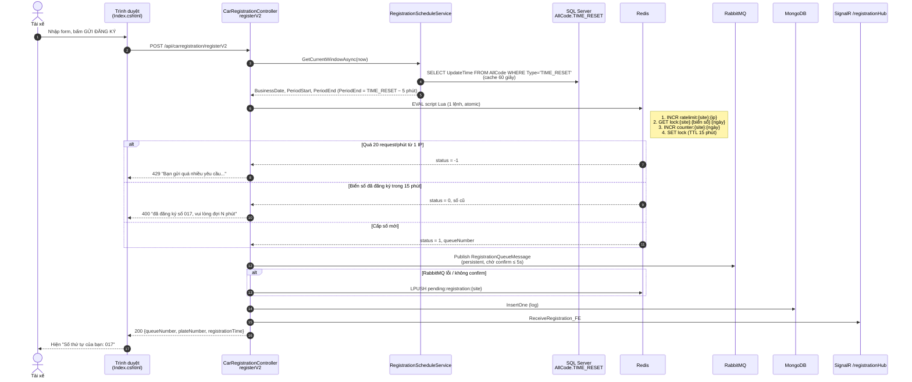
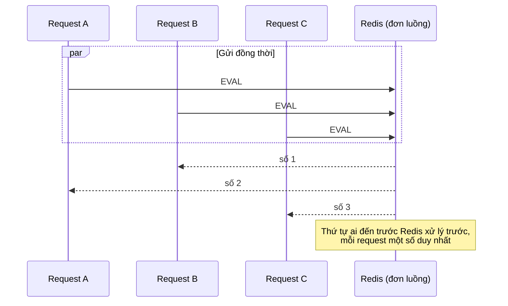
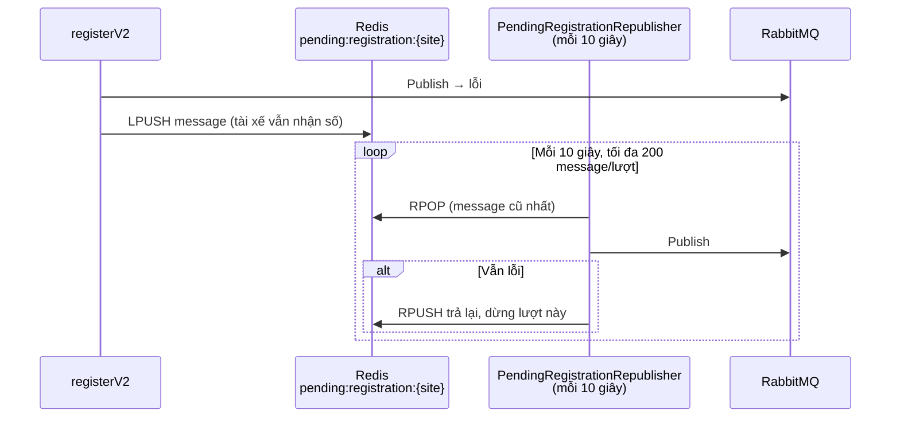
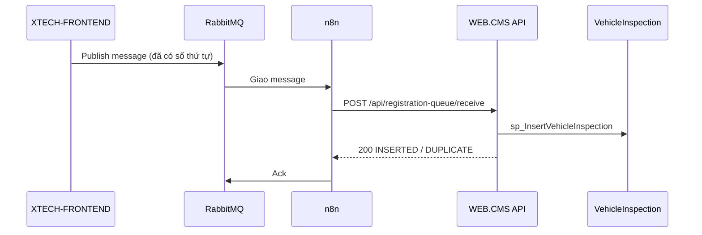

# XTECH-FRONTEND – Cổng đăng ký xe cho tài xế (Bình Dương)

> Tài liệu này phải được cập nhật mỗi khi code trong `XTECH-FRONTEND` thay đổi.
> Lịch sử thay đổi xem ở [CHANGELOG.md](CHANGELOG.md).

## 1. Mục đích

Trang web công khai để tài xế nhập thông tin xe và nhận **số thứ tự** vào nhà máy trong ngày.
Dữ liệu đăng ký được đẩy vào **RabbitMQ**; n8n đọc queue và gọi API của WEB.CMS để ghi bảng
`VehicleInspection` (SQL Server) cho CMS xử lý tiếp (bảo vệ, cân, máng...).

- Công nghệ: ASP.NET Core 6 (MVC + Web API + SignalR), chạy trên IIS.
- Không còn gọi API ngoài `api.longancargill.com` (đã ngắt từ 04/10/2026).

## 2. Các dịch vụ mà Frontend kết nối

| Dịch vụ | Cấu hình (`appsettings.json`) | Dùng để làm gì |
|---|---|---|
| Redis | `Redis:Host`, `Redis:Port`, db `Redis:Database:db_common` (15) | Cấp số thứ tự (atomic), khóa biển số 15 phút, rate limit theo IP, outbox khi RabbitMQ lỗi |
| RabbitMQ | `Queue:Host`, `Queue:V_Host`, `Queue:Username/Password`, `Queue:AmqpPort` (5672), `Queue:QueueRegistration` | Nhận message đăng ký (durable, persistent, publisher confirm) |
| SQL Server | `DataBaseConfig:SqlServer:ConnectionString` (DB `Cargill_BinhDuong_v2`) | **Chỉ đọc** `AllCode.TIME_RESET` để biết giờ reset số thứ tự |
| MongoDB | `MongoServer:*`, collection `Data_Car_Binh_Duong` | Bản sao log đăng ký, phục vụ trang `/ListData` |
| SignalR (nội bộ) | Hub `/registrationHub` | Đẩy xe mới đăng ký lên `/ListData` theo thời gian thực |
| Telegram Bot | `BotSetting:*` | Cảnh báo lỗi / request chậm |
| Google Sheets, Zalo OA | `GoogleSheets:*`, hard-code trong `ZaloOfficialAccountService` | Chỉ dùng ở luồng cũ `register-V1` (UI không gọi) |

## 3. Cấu trúc thư mục chính

```
XTECH-FRONTEND/
├── Program.cs                         Đăng ký DI (Redis, RabbitMQ, service cấp số, job outbox)
├── Controllers/
│   ├── HomeController.cs              GET / (form) – đọc giờ reset từ SQL; GET /ListData
│   └── API/CarRegistration/
│       └── CarRegistrationController.cs   POST /api/CarRegistration/registerV2 (luồng chính)
├── Services/
│   ├── Registration/
│   │   ├── RegistrationOptions.cs         Section "Registration" trong appsettings
│   │   ├── RegistrationScheduleService.cs Đọc AllCode.TIME_RESET, tính đợt + mốc reset số thứ tự
│   │   └── RedisQueueNumberAllocator.cs   Script Lua: rate limit → chống trùng → INCR số thứ tự
│   ├── Queue/
│   │   ├── RabbitMqRegistrationPublisher.cs  Publish message (singleton, lock, confirm)
│   │   ├── PendingRegistrationStore.cs       Outbox Redis khi publish lỗi
│   │   └── PendingRegistrationRepublisher.cs Job nền publish lại outbox mỗi 10 giây
│   └── MongoService.cs                Ghi/đọc log MongoDB (dùng chung 1 MongoClient)
├── Repositories/                      ValidationService, RegistrationHub, GoogleSheets/Zalo (luồng cũ)
├── Model/RegistrationQueueMessage.cs  Hợp đồng message gửi vào RabbitMQ
├── Views/Home/Index.cshtml            Form đăng ký (gọi '/api/carregistration/registerV2')
├── Views/Home/ListData.cshtml         Bảng realtime
└── Docs/                              Tài liệu dự án (thư mục này)
```

## 4. Luồng xử lý khi tài xế bấm "GỬI ĐĂNG KÝ"

### 4.1 Tóm tắt bằng lời

1. Trình duyệt gửi `POST /api/carregistration/registerV2` về **chính server đang mở trang**.
2. Server **không** kiểm tra định dạng dữ liệu (giữ như bản gốc; form kiểm tra bắt buộc nhập).
3. Server tính **đợt** từ giờ `TIME_RESET`: số thứ tự về 1 lúc `TIME_RESET − 5 phút`. **Không chặn** đăng ký trong khoảng nào.
4. Server chạy **1 script Lua trên Redis** (atomic, không thể chen ngang):
   rate limit theo IP → biển số đã đăng ký chưa → `INCR` lấy số thứ tự mới.
5. Server publish message vào RabbitMQ. Nếu RabbitMQ lỗi → lưu tạm vào outbox Redis.
6. Ghi log MongoDB, bắn SignalR cho `/ListData`.
7. Trả số thứ tự về trình duyệt ngay (không chờ ghi SQL).
8. n8n đọc queue → gọi API WEB.CMS `/api/registration-queue/receive` → ghi `VehicleInspection` → báo CMS (mục 7).

### 4.2 Sơ đồ Sequence



### 4.3 Vì sao 30 người bấm cùng lúc vẫn nhận số đúng

Redis thực thi script Lua **tuần tự từng cái một**. 30 request đồng thời sẽ chạy 30 lần script nối tiếp,
`INCR` trả về 1, 2, …, 30 cho từng request – không trùng, không mất số. Mỗi request nhận đúng số của mình
trong response HTTP. Thứ tự message trong RabbitMQ không quan trọng vì số thứ tự đã nằm sẵn trong message.



### 4.4 Khi RabbitMQ lỗi (outbox)



## 5. Quy tắc đợt đăng ký và reset số thứ tự (quy tắc gốc của dự án)

- Giờ reset lấy từ `AllCode.TIME_RESET` (CMS cấu hình ở màn `/Configuration`), chỉ dùng giờ:phút.
  Không đọc được thì dùng `Registration:DefaultResetTime` (17:55).
- Số thứ tự về 1 lúc `TIME_RESET − Registration:CounterResetOffsetMinutes` (5 phút), giống bản gốc.
- `PeriodEnd` = lần reset số kế tiếp, `PeriodStart` = `PeriodEnd − 1 ngày`.
- **Không chặn đăng ký** ở bất kỳ thời điểm nào.
- `BusinessDate` = ngày của `PeriodEnd`. Counter Redis là `counter:{Site}:{yyyyMMdd}`,
  sang đợt mới tự bắt đầu lại từ 1. Đổi giờ reset trong ngày **không** làm reset số.

Ví dụ với giờ reset 18:00: đăng ký lúc 10:00 ngày 04/10 → BusinessDate 04/10;
đăng ký lúc 17:56 ngày 04/10 → BusinessDate 05/10, số bắt đầu lại từ 001.

## 6. Key Redis (db 15)

| Key | Kiểu | TTL | Ý nghĩa |
|---|---|---|---|
| `counter:{Site}:{yyyyMMdd}` | string (số) | 3 ngày | Số thứ tự đã cấp của ngày làm việc |
| `lock:{Site}:{biển số chuẩn hóa}:{yyyyMMdd}` | string (số đã cấp) | 15 phút | Chặn đăng ký trùng |
| `ratelimit:{Site}:{IP}` | string (đếm) | 60 giây | Rate limit 20 request/phút/IP |
| `pending:registration:{Site}` | list (JSON) | không | Outbox message chưa publish được |

Biển số chuẩn hóa = chữ in hoa, bỏ mọi ký tự không phải chữ/số (`30E-453.21` → `30E45321`).

## 7. Hợp đồng message RabbitMQ

Queue: `Queue:QueueRegistration` (mặc định `QUEUE_CAR_REGISTRATION_BINH_DUONG`), **durable**,
message **persistent**, `ContentType = application/json`, `MessageId` = `MessageId` trong body.

```json
{
  "MessageId": "8f2c4a9e-...",
  "Site": "BINH_DUONG",
  "LocationType": 3,
  "BusinessDate": "2026-10-04",
  "QueueNumber": 17,
  "RegistrationTime": "2026-10-04T10:15:30.123+07:00",
  "PlateNumber": "30E45321",
  "PhoneNumber": "0942066299",
  "Name": "CƯỜNG - 123456",
  "GPLX": "LÊ VĂN CƯỜNG",
  "Referee": "0",
  "Camp": "ghi chú",
  "ZaloStatus": "Đang xử lý..."
}
```

Ánh xạ sang `sp_InsertVehicleInspection` (theo `App_Push_Consummer/Model/DB_Core/Repository.cs`):
`QueueNumber→@RecordNumber`, `Name→@CustomerName`, `PlateNumber→@VehicleNumber`,
`RegistrationTime→@RegisterDateOnline`, `GPLX→@DriverName`, `Camp→@LicenseNumber`,
`PhoneNumber→@PhoneNumber`, `Referee→@VehicleLoad`.

### Consumer: n8n + API của WEB.CMS

Consumer chạy trên **n8n**: node RabbitMQ Trigger hứng message rồi gọi
`POST /api/registration-queue/receive` của **WEB.CMS** (header `X-Api-Key`). WEB.CMS lo phần
ghi SQL, chống trùng theo `MessageId`, publish realtime và queue audio.
Chi tiết: `source/WEB.CMS/Docs/README.md`.



Yêu cầu với n8n:

1. Queue khai báo `durable: true` (khác `durable` sẽ lỗi `PRECONDITION_FAILED`).
2. Chỉ ack **sau khi** API trả `200`; lỗi `409/500/503` thì để RabbitMQ giao lại.
3. `400` là message hỏng: ghi lại rồi ack, gửi lại cũng không thành công.

**Lưu ý vận hành:** khi workflow n8n chưa chạy, message nằm trong queue và CMS chưa thấy xe mới.

## 8. API endpoints

| Method | URL | Trạng thái | Ghi chú |
|---|---|---|---|
| GET | `/` | Đang dùng | Form đăng ký, `ViewBag.Data` = giờ reset hôm nay |
| GET | `/ListData` | Đang dùng | Danh sách đăng ký từ MongoDB + realtime SignalR |
| POST | `/api/CarRegistration/registerV2` | **Luồng chính** | Mô tả ở mục 4 |
| POST | `/api/CarRegistration/register-V1` | Luồng cũ | Google Sheets + Zalo, UI không gọi |
| GET | `/api/CarRegistration/check-restriction/{plate}` | Luồng cũ | MemoryCache |
| GET | `/api/CarRegistration/queue-status` | Luồng cũ | Đọc Google Sheets |
| GET | `/api/CarRegistration/check-zalo-user/{phone}` | Luồng cũ | Zalo OA |

Mã phản hồi của `registerV2`: `200` thành công; `400` thiếu dữ liệu / trùng biển số trong 15 phút;
`429` quá giới hạn request; `500` lỗi hệ thống.

## 9. Cấu hình `Registration`

| Key | Mặc định | Ý nghĩa |
|---|---|---|
| `Site` | `BINH_DUONG` | Tiền tố key Redis, ghi vào message |
| `LocationType` | `3` | Ghi vào message cho consumer |
| `LockMinutes` | `15` | Thời gian chặn đăng ký trùng biển số |
| `CounterResetOffsetMinutes` | `5` | Số thứ tự về 1 trước giờ `TIME_RESET` bao nhiêu phút (quy tắc gốc) |
| `DefaultResetTime` | `17:55` | Giờ reset khi không đọc được SQL |
| `ResetTimeCacheSeconds` | `60` | Cache giờ reset |
| `RateLimitPerWindow` / `RateLimitWindowSeconds` | `20` / `60` | Rate limit theo IP |
| `PendingRepublishSeconds` | `10` | Chu kỳ job outbox |

## 10. Kiểm tra nhanh sau khi deploy

- Redis: `redis-cli -h <host> -p 6666 -n 15 GET counter:BINH_DUONG:<yyyyMMdd>` → số đã cấp.
- RabbitMQ: web quản trị cổng 15672, vhost `booking_car`, queue `QUEUE_CAR_REGISTRATION_BINH_DUONG`.
- Outbox: `LLEN pending:registration:BINH_DUONG` phải về 0.
- Log chậm: `Logs/slow_requests.log` (request > 1 giây).
