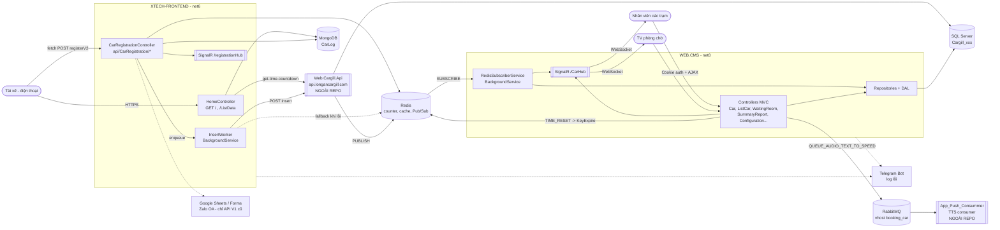

# Web Car Flow – Tài liệu luồng chạy hệ thống

> Tài liệu này mô tả kiến trúc, luồng dữ liệu và các dịch vụ bên ngoài của bộ source `web_car_flow`
> (clone từ chi nhánh **Bình Định** sang **Bình Dương**). Viết để người mới và AI agent đọc là hiểu
> hệ thống trước khi sửa code hoặc triển khai.
>
> Sơ đồ sequence chi tiết: xem [`SEQUENCE_DIAGRAMS.md`](./SEQUENCE_DIAGRAMS.md).

---

## 1. Hệ thống làm gì

Hệ thống điều phối xe tải vào nhà máy Cargill để **lấy hàng (xuất cám)**:

1. **Tài xế** quét QR / mở web, điền form đăng ký (biển số, SĐT, khách hàng, trọng tải...) và nhận **số thứ tự** trong ngày.
2. Xe được đưa vào danh sách trong **CMS nội bộ**. Nhân viên ở từng trạm (bảo vệ, CS, cân, máng xuất) cập nhật trạng thái xe.
3. Mọi thay đổi được **đẩy realtime** (SignalR) tới các màn hình khác, kể cả TV phòng chờ.
4. Hệ thống **gọi loa** (audio text-to-speech) mời xe vào cân / vào máng.

---

## 2. Thành phần trong solution `XTECH-FRONTEND.sln`

| Project | Loại | .NET | Vai trò |
|---|---|---|---|
| `XTECH-FRONTEND` | ASP.NET Core MVC + Web API | net6.0 | **Frontend cho tài xế**: form đăng ký xe và API `api/CarRegistration/*`. Không dùng SQL Server trực tiếp. |
| `WEB.CMS` (`Web.Cargill.CMS.csproj`) | ASP.NET Core MVC | net8.0 | **Backend / CMS nội bộ**: quản lý trạng thái xe theo trạm, báo cáo, user/role/menu. |
| `Repositories` | Class library | | Lớp nghiệp vụ, gọi DAL. Mỗi hàm list đều đọc `AllCode.TIME_RESET` để xác định "ngày làm việc". |
| `DAL` | Class library | | Truy cập SQL Server. Chủ yếu gọi **Stored Procedure** qua `DAL/StoreProcedure/DbWorker.cs`, một phần dùng EF Core (`Entities/Models/EntityDataContext.cs`). |
| `Entities` | Class library | | Model EF (`VehicleInspection`, `TroughWeight`, `VehicleAudio`, `AllCode`, `User`...) và ViewModel. |
| `Utilities` | Class library | | Hằng số (status enum, tên SP), `LogHelper` (Telegram), helper mã hóa token... |

`XTECH-FRONTEND` **không** reference các project DAL/Repositories. `WEB.CMS` reference cả 4 library.

### Các thành phần KHÔNG có trong repo này (nhưng hệ thống phụ thuộc)

Suy ra từ code và từ `.gitignore` (có `Web.Cargill.Api/` và `App_Push_Consummer/`):

| Thành phần ngoài | Bằng chứng | Vai trò (suy luận) |
|---|---|---|
| **Web.Cargill.Api** (đang được gọi qua `http://api.longancargill.com`) | FE gọi `POST /api/vehicleInspection/insert` và `GET /api/vehicleInspection/get-time-countdown?LocationType=3` | Ghi bản ghi đăng ký vào bảng `VehicleInspection` (SQL Server), **publish Redis** channel `Add_ReceiveRegistration_BinhDinh` / `_DK` để CMS nhận realtime, trả giờ reset/đếm ngược. |
| **App_Push_Consummer** | CMS đẩy message vào RabbitMQ queue `QUEUE_AUDIO_TEXT_TO_SPEED`, nhưng không có consumer nào trong repo | Đọc queue, sinh file mp3 "Mời biển số xe ... vào cân", lưu đường dẫn vào `VehicleAudio` / `AudioPath`. Có thể là nơi publish `ListCartoFactory_Cam`. |

> Khi triển khai Bình Dương **bắt buộc** phải có source/deploy riêng của 2 thành phần trên, nếu không luồng đăng ký sẽ không vào được CMS và không có audio gọi xe.

---

## 3. Sơ đồ kiến trúc tổng quan



---

## 4. XTECH-FRONTEND (cổng tài xế)

### 4.1 Route / Endpoint

| Method | Route | File | Mô tả |
|---|---|---|---|
| GET | `/` | `Controllers/HomeController.cs` → `Index` | Gọi API ngoài `get-time-countdown?LocationType=3` lấy giờ chốt sổ, render form `Views/Home/Index.cshtml`. |
| GET | `/ListData` | `HomeController.ListData` | Đọc MongoDB (các xe đăng ký từ 17:55 hôm trước / hôm nay), hiển thị bảng + nghe SignalR `ReceiveRegistration_FE`. |
| POST | `/api/CarRegistration/registerV2` | `Controllers/API/CarRegistration/CarRegistrationController.cs` | **Luồng đăng ký đang dùng.** |
| POST | `/api/CarRegistration/register-V1` | cùng file | Luồng cũ: Google Sheets + Google Forms + Zalo OA. Form hiện tại **không** gọi. |
| GET | `/api/CarRegistration/check-restriction/{plate}` | cùng file | Kiểm tra rule 15 phút (MemoryCache). |
| GET | `/api/CarRegistration/queue-status` | cùng file | Đếm số thứ tự từ Google Sheets (cũ). |
| GET | `/api/CarRegistration/check-zalo-user/{phone}` | cùng file | Gọi Zalo OA `https://openapi.zalo.me/v3.0/oa`. |
| POST | `/api/CarRegistration/insert` | cùng file | Proxy đồng bộ tới API ngoài + log Telegram (thay thế bằng `InsertWorker`). |
| WS | `/registrationHub` | `Repositories/RegistrationHub.cs` | SignalR hub phía FE. |

Form JS gọi API qua hằng số **hard-code** trong `Views/Home/Index.cshtml`:

```js
const API_BASE_URL = 'https://cargillbinhdinh.com/api';
```

### 4.2 Luồng `registerV2` (tóm tắt)

1. Check trùng: Redis key `BinhDinh_PlateNumber_{BIEN_SO}{dd_MM_yyyy}` (db `db_common`=15). Có → trả lỗi "đợi 15 phút".
2. Cấp số thứ tự: Redis `INCR counter:daily_car_count_Pro_Binh_Dinh`. Lần đầu trong ngày set TTL = (giờ `Timedow` từ form − 5 phút).
3. Set key chống trùng với TTL 15 phút.
4. Insert MongoDB: database `CarLog`, collection `Data_Car_Binh_Dinh` (retry 1 lần).
5. SignalR `ReceiveRegistration_FE` tới các client `/ListData`.
6. Đẩy job vào hàng đợi in-memory (`Channel`) → `InsertWorker` POST tới `http://api.longancargill.com/api/vehicleInspection/insert` với `LocationType=3`.
   - Nếu exception: append bản ghi vào Redis key `CARGLL_BinhDinh` (để xử lý lại thủ công) + log Telegram.
7. Trả về ngay cho tài xế: số thứ tự, giờ đăng ký.

### 4.3 Dịch vụ FE kết nối (`appsettings.json`)

| Key | Dịch vụ | Dùng ở |
|---|---|---|
| `Redis:Host/Port`, `Redis:Database:db_common` | Redis | `RedisConn`, `GoogleSheetsService.GetDailyQueueCountRedis`, `InsertWorker` |
| `MongoServer:*` (`catalog_log`, `Data_Car`) | MongoDB | `Services/MongoService.cs` |
| `Queue:*` (`QueueSyncES=Queue_Order_Car_V2`) | RabbitMQ | `Services/WorkQueueClient.cs` – **được khởi tạo nhưng không được gọi** |
| `BotSetting:*` | Telegram | `Utilities/LogHelper.cs` (đọc lại file `appsettings.json` mỗi lần log) |
| `GoogleSheets:*`, `GoogleForms:*` | Google API | Chỉ API V1 cũ |
| `DataBaseConfig:SqlServer` | SQL Server | Khai báo nhưng FE **không dùng** |
| *hard-code* | `api.longancargill.com` | `HomeController`, `InsertWorker`, `CarRegistrationController.Insert` |
| *hard-code* | Zalo OA | `Repositories/ZaloOfficialAccountService.cs` |

---

## 5. WEB.CMS (backend nội bộ)

### 5.1 Khởi động (`WEB.CMS/Program.cs`)

- Cookie auth `Net.Security.Cookie`, hết hạn 60 phút (sliding). Chưa login → `/Account/RedirectLogin`.
- Tất cả repository đăng ký **Singleton**.
- `RedisConn` singleton + hosted service `RedisSubscriberService` (subscribe Redis Pub/Sub khi app start).
- SignalR hub `/CarHub` (KeepAlive 15s, timeout 60s). Client JS kết nối bằng WebSockets, `skipNegotiation: true` → **IIS phải bật WebSocket Protocol**.

### 5.2 Đăng nhập & phân quyền

- `POST /Account/ConfirmLogin` → `UserRepository.CheckExistAccount` (SQL) → kiểm tra `Status == 0` → tạo cookie với claims (Id, UserName, DepartmentId, Email, Role) + load quyền `GetUserPermissionById`.
- `GET /login/token/{token}`: SSO bằng token mã hóa với key `DataBaseConfig:key_api:api_manual`, hạn `config.json:LoginTokenExprire` phút.
- `[CustomAuthorize]` chỉ kiểm tra **đã đăng nhập** (`IsAllowAccess = true` cứng) – chưa check quyền theo menu.
- `ManagementUser` cache quyền user trong Redis key `USER_ROLE{userId}_{CompanyType}`.

### 5.3 Các màn hình theo trạm (luồng nghiệp vụ của một xe)

| Thứ tự | Màn hình (URL) | Tiêu đề | JS module | `UpdateStatus type` | Event SignalR phát ra |
|---|---|---|---|---|---|
| 0 | `/Car/RegisteredVehicle` | Danh sách xe đăng ký | `registeredvehicle.js` | `UpdateRegisteredVehicle` | `ListCartoFactory`, `ListCartoFactory_Da_SL` (nghe `ReceiveRegistration_DK`) |
| 1 | `/Car/CartoFactory` | Danh sách xe đăng ký (bảo vệ xác nhận đến NM) | `cartofactory.js` | 1 – `VehicleStatus` | `ListCartoFactory`, `ListCartoFactory_Da_SL`, `ListCartoFactory_rac` (nghe `ReceiveRegistration`) |
| 2 | `/Car/ProcessingIsLoading` | Xe đã đến nhà máy (CS xử lý) | `processingIsloading.js` | 2 – `LoadType`/Rank, 8 – `LoadingStatus`, 10 – LoadingType, 11 – Rank, 12 – CSNotes | `ListProcessingIsLoading`, `ListProcessingIsLoading_Da_SL`, `ProcessingIsLoading_khoa` |
| 3 | `/Car/CallTheScale` | Gọi xe vào cân (phát audio) | `callthescale.js` | 3 – `VehicleWeighingType` | `ListCallTheScale_0`, `ListCallTheScale_1`, `ListCallTheScale_Da_SL` |
| 4 | `/Car/WeighedInput` | Xe đã cân xong đầu vào | `weighedinput.js` | 9 – `VehicleWeighedstatus` | `ListWeighedInput`, `ListWeighedInput_Da_SL` |
| 5 | `/ListCar/CarCallList` | Gọi xe vào máng | `cartcalllist.js` | 4 – chọn máng, 6 – trạng thái máng, 13 – Note | `UpdateMangStatus`, `ListCarCall`, `ListCarCall_Da_SL`, `ListCarCall_Bo_LUOT` |
| 6 | `/ListCar/ListVehicles` | Xe đã cân ra | `listVehicles.js` | 7 – `VehicleWeighingStatus` | `ListVehicles`, `ListVehicles_Da_SL` |
| TV | `/WaitingRoom/Index`, `/WaitingRoom/CarCall` | Phòng chờ / Điều phối xe | `waitingroom.js`, `waitingroom_call.js` | – | chỉ nghe |

Tất cả đều gọi chung `POST /Car/UpdateStatus?id&status&type&weight&Note`
(`WEB.CMS/Controllers/CarController.cs`). Mỗi `type` cập nhật 1 nhóm cột của bảng `VehicleInspection`
qua SP `sp_UpdateVehicleInspection`, đọc tên trạng thái từ bảng `AllCode`, rồi broadcast `Clients.All`.

Giá trị enum quan trọng (`Utilities/Contants/VehicleStatus.cs`):

- `VehicleStatus`: 0 Đã đến NM, 1 Blank, 2 Rác
- `VehicleWeighingType`: 0 Đã vào cân, 1 Blank
- `LoadType`: 0 Xanh, 1 Thường, 2 Đỏ
- `LoadingStatus`: 0 Đã hoàn thành thủ tục, 1 Blank
- `VehicleWeighedstatus`: 0 Đã cân xong đầu cao, 1 Blank
- `VehicleWeighingStatus`: 0 Đã cân ra, 1 Quay lại KT, 2 Blank
- `VehicleTroughStatus`: 0 Hoàn thành, 1 Đã gọi, 2 Bốc hàng, 3 Blank, 4 Bỏ lượt, 5 Ngắt máng

### 5.4 Các luồng phụ

- **Gọi loa / audio**: `POST /Car/UpdateName` (khi sửa biển số) → `GetAudioPathByVehicleNumber` (SP `SP_GetDetailVehicleAudioByPlateNumber`). Nếu chưa có audio → push RabbitMQ queue `QUEUE_AUDIO_TEXT_TO_SPEED` với `text_voice = "Mời biển số xe {BS} vào cân"`. Màn `CallTheScale` phát `<audio src="@item.AudioPath">`.
- **Cấu hình giờ reset ngày** (`/Configuration`): `Setup(time,id)` → update `AllCode` type `TIME_RESET` → `RedisConn.checkTime` set TTL cho counter số thứ tự. Giờ này cũng quyết định "ngày làm việc" cho tất cả list/báo cáo.
- **Báo cáo** (`/SummaryReport/*`): thống kê theo ngày, theo giờ, theo máng, theo nhóm tải, xuất Excel (EPPlus) – SP `SP_GetListVehicleInspectionSynthetic`, `SP_CountTotalVehicleInspectionSynthetic`, `SP_GetTotalWeightBy*`, `SP_GetListVehicleInspectionTimeProductDelivery`.
- **Đăng kiểm** (`/Inspection`): CRUD bảng `Inspection` (SP `SP_GetListInspection`, `SP_InsertInspection`, `SP_UpdateInspection`).
- **Quản trị**: `/User`, `/Role`, `/Menu`, `/Department`.

### 5.5 Redis Pub/Sub mà CMS lắng nghe (`Services/RedisSubscriberService.cs`)

| Channel | Payload | Xử lý | Event SignalR |
|---|---|---|---|
| `Add_ReceiveRegistration_BinhDinh` | `RegistrationRecord` | Lấy `TrangThai` từ SQL `SP_GetDetailtVehicleInspection` | `ReceiveRegistration` → `CartoFactory` |
| `Add_ReceiveRegistration_BinhDinh_DK` | `RegistrationRecord` | như trên | `ReceiveRegistration_DK` → `RegisteredVehicle` |
| `ListCartoFactory_Cam` | `CartoFactoryModel` | forward | `ListCartoFactory_Da_SL` |

**Không có code nào trong repo publish các channel này** → bên publish là API ngoài (mục 2).

### 5.6 Dịch vụ CMS kết nối (`WEB.CMS/appsettings.json` + `config.json`)

| Key | Dịch vụ | Ghi chú |
|---|---|---|
| `DataBaseConfig:SqlServer:ConnectionString` | SQL Server, DB `Cargill_BinhDinh` | Toàn bộ dữ liệu nghiệp vụ |
| `DataBaseConfig:key_api:api_manual` | – | Key mã hóa token SSO / cache quyền |
| `Redis:*` | Redis | Pub/Sub, cache quyền, counter |
| `Queue:*` (`QueueSyncES=QUEUE_AUDIO_TEXT_TO_SPEED`) | RabbitMQ vhost `booking_car` | Audio TTS |
| `BotSetting:*` | Telegram | Log lỗi (`Utilities/LogHelper.cs`), kể cả mọi lỗi SP trong `DbWorker` |
| `CompanyType` | – | Hậu tố key cache quyền |
| `config.json:LoginURL`, `LoginTokenExprire` | – | Redirect khi SSO lỗi |

Lưu ý: `Entities/Models/EntityDataContext.cs` có **connection string hard-code** fallback tới `103.163.216.41 / Cargill_BinhDinh`.

---

## 6. Kho dữ liệu dùng chung

| Store | Ai ghi | Ai đọc | Key / bảng chính |
|---|---|---|---|
| SQL Server `Cargill_*` | API ngoài (insert), CMS (update) | CMS | `VehicleInspection`, `TroughWeight`, `VehicleAudio`, `AllCode`, `User`, `Role`, `Menu`... |
| Redis db 15 | FE, CMS, API ngoài | FE, CMS | `counter:daily_car_count_Pro_Binh_Dinh`, `BinhDinh_PlateNumber_*`, `CARGLL_BinhDinh`, `USER_ROLE*`, channel Pub/Sub |
| MongoDB `CarLog` | FE | FE (`/ListData`) | collection `Data_Car_Binh_Dinh` |
| RabbitMQ `booking_car` | CMS | TTS consumer ngoài | queue `QUEUE_AUDIO_TEXT_TO_SPEED` |

---

## 7. Danh sách cần đổi khi triển khai chi nhánh Bình Dương

Code đang **hard-code tên chi nhánh / domain**. Tìm và thay tất cả trước khi chạy song song với Bình Định, nếu không 2 chi nhánh sẽ **dùng chung counter, chung dữ liệu và bắn nhầm realtime**.

| Vị trí | Giá trị hiện tại | Cần đổi |
|---|---|---|
| `XTECH-FRONTEND/Views/Home/Index.cshtml` | `API_BASE_URL = 'https://cargillbinhdinh.com/api'` | Domain FE Bình Dương |
| `XTECH-FRONTEND/Controllers/HomeController.cs` | `api.longancargill.com/...get-time-countdown?LocationType=3` | URL API Bình Dương + `LocationType` mới |
| `XTECH-FRONTEND/Services/BackgroundQueue/InsertWorker.cs` | `api.longancargill.com/api/vehicleInspection/insert`, `CARGLL_BinhDinh` | URL API + key fallback mới |
| `XTECH-FRONTEND/Controllers/API/CarRegistration/CarRegistrationController.cs` | `BinhDinh_PlateNumber_`, `LocationType=3`, URL insert | Prefix + LocationType mới |
| `XTECH-FRONTEND/Repositories/GoogleSheetsService.cs` | `counter:daily_car_count_Pro_Binh_Dinh` | Counter riêng |
| `WEB.CMS/Services/RedisConn.cs` → `checkTime` | `counter:daily_car_count_Pro_Long_An` | **Phải trùng** với counter FE (xem mục 8) |
| `WEB.CMS/Services/RedisSubscriberService.cs` | `Add_ReceiveRegistration_BinhDinh`, `_DK`, `ListCartoFactory_Cam` | Channel riêng, khớp với API ngoài |
| `XTECH-FRONTEND/appsettings.json` | `MongoServer:Data_Car = Data_Car_Binh_Dinh`, `BotSetting`, `GoogleSheets` | Collection / bot / sheet mới |
| `WEB.CMS/appsettings.json` | `Initial Catalog=Cargill_BinhDinh`, `BotSetting.environment`, `Queue` | DB mới, nhãn môi trường mới |
| `Entities/Models/EntityDataContext.cs` | connection string hard-code | DB mới hoặc bỏ hard-code |
| `WEB.CMS/config.json` | `LoginURL = https://localhost:44384/` | URL CMS thật |
| API ngoài + TTS consumer | – | Deploy bản Bình Dương, publish đúng channel mới |

Gợi ý: đưa các giá trị trên vào `appsettings.json` (ví dụ `Branch:Code`, `Branch:ApiBaseUrl`, `Branch:LocationType`) thay vì hard-code.

---

## 8. Rủi ro / điểm bất thường phát hiện khi đọc code

1. **Counter số thứ tự lệch tên key**: FE tăng `counter:daily_car_count_Pro_Binh_Dinh`, nhưng CMS `/Configuration` lại set TTL cho `counter:daily_car_count_Pro_Long_An` → đổi giờ reset trên CMS **không ảnh hưởng** counter của FE.
2. FE Bình Định đang gọi API domain **Long An** (`api.longancargill.com`) – có thể là API dùng chung phân biệt bằng `LocationType`, cần xác nhận với người vận hành.
3. Thư mục `XTECH-FRONTEND/pipeline_jenkins` trỏ tới repo `frontend-company-xtech` và site IIS `Xtech.FE` – là pipeline cũ, không phản ánh deploy hiện tại. Publish profile trỏ thư mục `..._Long_an` → deploy đang làm thủ công qua Folder Publish.
4. `RedisConn` của FE được `new` + `Connect()` **mỗi request** trong constructor `CarRegistrationController`, `GetDailyQueueCountRedis` cũng tạo `ConnectionMultiplexer` mới mỗi lần → tốn kết nối khi tải cao.
5. `MongoService` tạo `MongoClient` mới mỗi lần gọi.
6. `InsertWorker` khi lỗi chỉ lưu Redis `CARGLL_BinhDinh` nếu key đã có dữ liệu (logic `if data != null` mới `Add`) → bản ghi lỗi đầu tiên có thể **bị mất**.
7. `[CustomAuthorize]` không kiểm tra quyền menu, user đăng nhập vào được mọi trang.
8. Secrets (DB password, Telegram token, Google service-account private key, Mongo password) đang nằm trong `appsettings.json`; `LogHelper` FE còn hard-code bot token mặc định.
9. `Program.cs` CMS: `if (!IsDevelopment) UseDeveloperExceptionPage()` – logic đảo ngược, production sẽ hiện stack trace.
10. `StoreProcedureConstant.sp_InsertTroughWeight` trỏ nhầm tên SP (`SP_GetListTroughWeightByVehicleInspectionId`); code thật dùng `SP_InsertTroughWeight`.

---

## 9. Chạy local / triển khai

- Mở `XTECH-FRONTEND.sln` bằng Visual Studio 2022 (cần .NET 6 SDK và .NET 8 SDK).
- `appsettings.json` của `WEB.CMS` và `XTECH-FRONTEND` **bị `.gitignore`** – phải tự tạo lại trên máy/server theo cấu trúc ở mục 4.3 và 5.6.
- FE local: `https://localhost:62989`. CMS: xem `WEB.CMS/Properties/launchSettings.json`.
- Deploy: IIS, `web.config` hosting `inprocess` (`AspNetCoreModuleV2`). Bật **WebSocket Protocol** cho site CMS (SignalR dùng `skipNegotiation` + WebSockets).
- Server cần mở kết nối outbound tới: SQL Server, Redis (port 6666), MongoDB (27017), RabbitMQ, `api.telegram.org`, API ngoài.
- Thứ tự khởi động khuyến nghị: SQL / Redis / Mongo / RabbitMQ → API ngoài + TTS consumer → WEB.CMS → XTECH-FRONTEND.

---

## 10. Bản đồ file quan trọng (cho AI tra cứu nhanh)

```
XTECH-FRONTEND/
  Program.cs                                  DI, route, SignalR /registrationHub
  Controllers/HomeController.cs               GET /, /ListData
  Controllers/API/CarRegistration/CarRegistrationController.cs   API đăng ký
  Services/BackgroundQueue/InsertWorker.cs    gọi API ngoài insert
  Services/RedisWorker/RedisConn.cs           Redis client
  Services/MongoService.cs                    MongoDB
  Repositories/GoogleSheetsService.cs         counter Redis + Google Sheets
  Views/Home/Index.cshtml                     form tài xế (JS fetch API_BASE_URL)
  Views/Home/ListData.cshtml                  bảng realtime
WEB.CMS/
  Program.cs                                  DI, auth, SignalR /CarHub
  Controllers/CarController.cs                UpdateStatus (state machine), UpdateName (audio)
  Controllers/ListCarController.cs            gọi máng, cân ra
  Controllers/WaitingRoomController.cs        TV phòng chờ
  Controllers/ConfigurationController.cs      giờ reset TIME_RESET
  Controllers/SummaryReportController.cs      báo cáo, export Excel
  Controllers/AccountController.cs            login, SSO token
  Services/RedisSubscriberService.cs          nhận Pub/Sub -> SignalR
  Services/WorkQueueClient.cs                 RabbitMQ publisher
  wwwroot/modules/*.js                        JS từng màn, nghe SignalR, gọi AJAX
Repositories/Repositories/VehicleInspectionRepository.cs
DAL/VehicleInspectionDAL.cs, DAL/StoreProcedure/DbWorker.cs
Utilities/Contants/StoreProcedureConstant.cs, VehicleStatus.cs, AllCodeType.cs
Utilities/LogHelper.cs                        Telegram log
```
