# Sơ đồ Sequence – Web Car Flow

> Đi kèm [`README.md`](./README.md). Các bước có nhãn **[NGOÀI REPO]** là suy luận từ code gọi tới,
> source thực tế nằm ở project `Web.Cargill.Api` / `App_Push_Consummer` (không có trong repo này).

Mục lục:

1. [Tài xế mở form đăng ký](#1-tài-xế-mở-form-đăng-ký)
2. [Tài xế gửi đăng ký (registerV2) – luồng chính end-to-end](#2-tài-xế-gửi-đăng-ký-registerv2--luồng-chính-end-to-end)
3. [Màn hình realtime /ListData của FE](#3-màn-hình-realtime-listdata-của-fe)
4. [Nhân viên đăng nhập CMS](#4-nhân-viên-đăng-nhập-cms)
5. [Mở một màn hình trạm trong CMS](#5-mở-một-màn-hình-trạm-trong-cms)
6. [Cập nhật trạng thái xe qua các trạm (UpdateStatus)](#6-cập-nhật-trạng-thái-xe-qua-các-trạm-updatestatus)
7. [Gọi loa – sinh audio mời xe vào cân](#7-gọi-loa--sinh-audio-mời-xe-vào-cân)
8. [Cấu hình giờ reset ngày làm việc](#8-cấu-hình-giờ-reset-ngày-làm-việc)
9. [Luồng đăng ký cũ register-V1 (Google + Zalo)](#9-luồng-đăng-ký-cũ-register-v1-google--zalo)
10. [Ghi log lỗi](#10-ghi-log-lỗi)

---

## 1. Tài xế mở form đăng ký

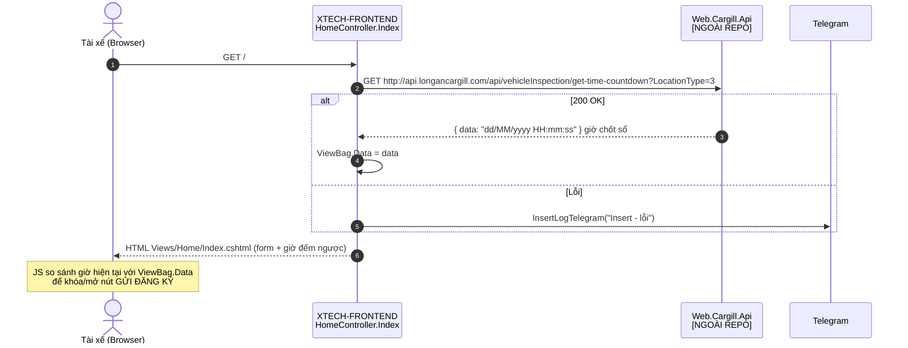

---

## 2. Tài xế gửi đăng ký (registerV2) – luồng chính end-to-end

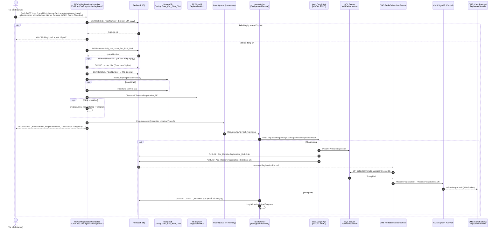

---

## 3. Màn hình realtime /ListData của FE

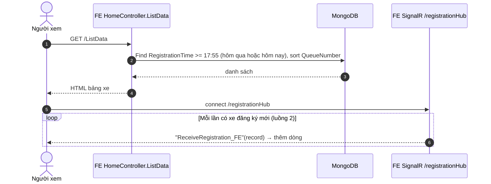

---

## 4. Nhân viên đăng nhập CMS

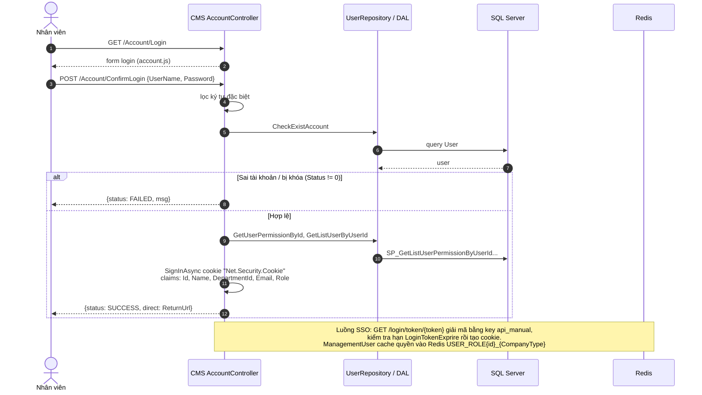

---

## 5. Mở một màn hình trạm trong CMS

Ví dụ màn `Gọi xe vào máng` – các màn khác (CartoFactory, ProcessingIsLoading, CallTheScale, WeighedInput, ListVehicles, WaitingRoom) giống hệt, chỉ khác URL/SP.

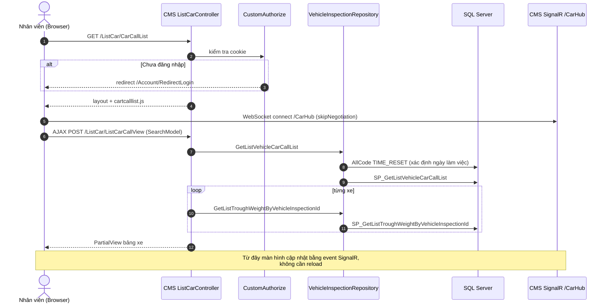

---

## 6. Cập nhật trạng thái xe qua các trạm (UpdateStatus)

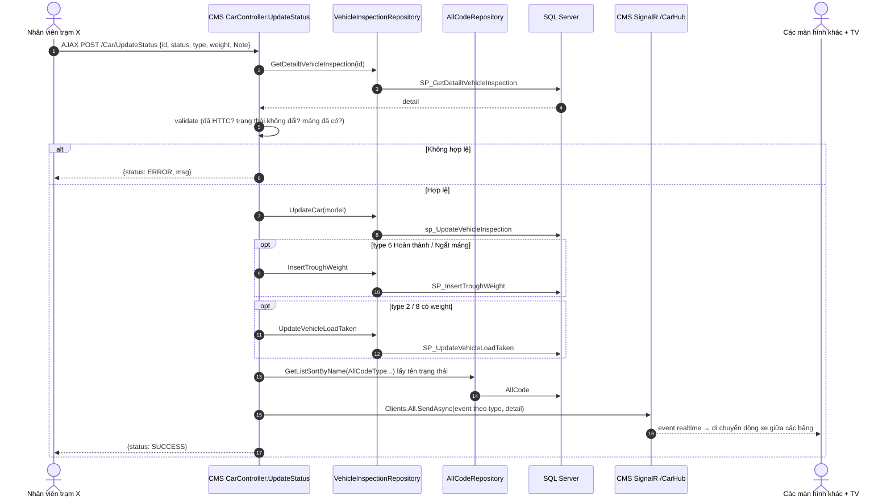

Bảng `type` → event SignalR:

| type | Trạm | Trường cập nhật | Event |
|---|---|---|---|
| 1 | Bảo vệ – xe đến NM | `VehicleStatus`, `VehicleArrivalDate`, `ProtectNotes` | `ListCartoFactory_Da_SL` (đã đến) / `ListCartoFactory_rac` / `ListCartoFactory` |
| 2 | CS – phân loại | `LoadType`, `Rank`, `VehicleLoadTaken` | `ListProcessingIsLoading` |
| 3 | Gọi vào cân | `VehicleWeighingType`, `VehicleWeighingTimeComeIn` | `ListCallTheScale_Da_SL` / `_0` (Xanh, Đỏ) / `_1` |
| 4 | Gọi vào máng | `TroughType`, `VehicleTroughStatus=Đã gọi` | `UpdateMangStatus` + `ListCarCall` |
| 5 | – | `VehicleTroughWeight` | `ListCartoFactory` |
| 6 | Máng | `VehicleTroughStatus` (Bốc hàng/Hoàn thành/Bỏ lượt/Ngắt máng) + `TroughWeight` | `ListCarCall_Da_SL` / `ListCarCall_Bo_LUOT` / `ListCarCall` |
| 7 | Cân ra | `VehicleWeighingStatus`, `VehicleWeighingTimeComplete` | `ListVehicles_Da_SL` / `ListVehicles` |
| 8 | CS – hoàn thành thủ tục | `LoadingStatus`, `ProcessingIsLoadingDate` | `ListProcessingIsLoading_Da_SL` / `ListProcessingIsLoading` |
| 9 | Cân đầu vào | `VehicleWeighedstatus`, `VehicleWeighingTimeComeOut` | `ListWeighedInput_Da_SL` / `ListWeighedInput` |
| 10 / 11 / 12 | CS | `LoadingType` / `Rank` / `CSNotes` | `ProcessingIsLoading_khoa` |
| 13 | Máng | `Note` | `ListCarCall` |

Luồng nghiệp vụ một xe (thứ tự trạm):

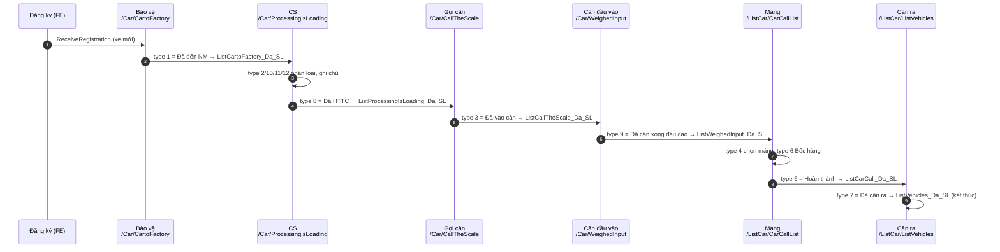

---

## 7. Gọi loa – sinh audio mời xe vào cân

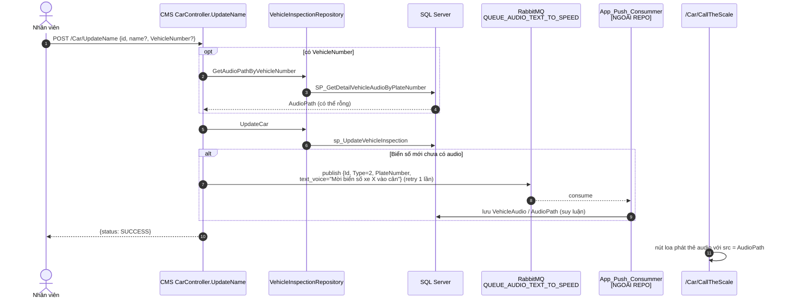

---

## 8. Cấu hình giờ reset ngày làm việc

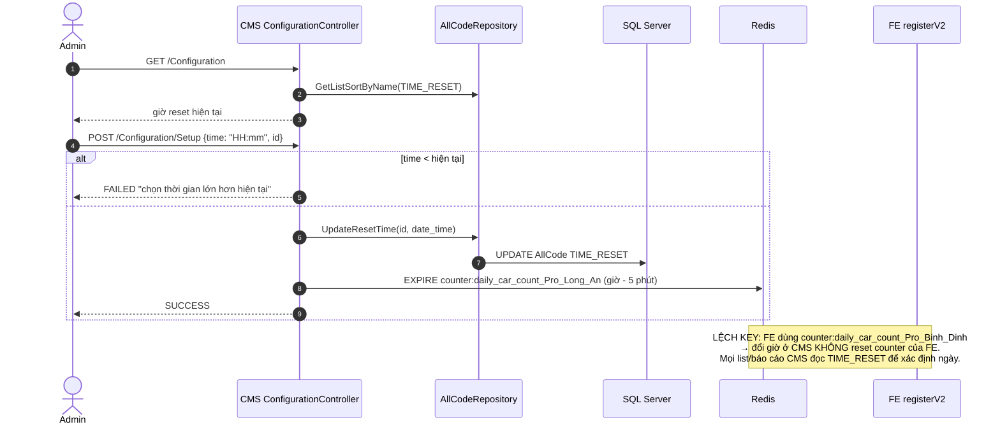

---

## 9. Luồng đăng ký cũ register-V1 (Google + Zalo)

Không còn được form gọi, giữ lại để tham khảo.

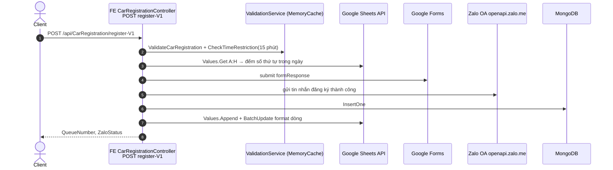

---

## 10. Ghi log lỗi

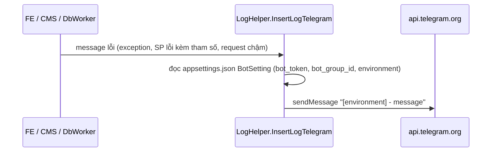
